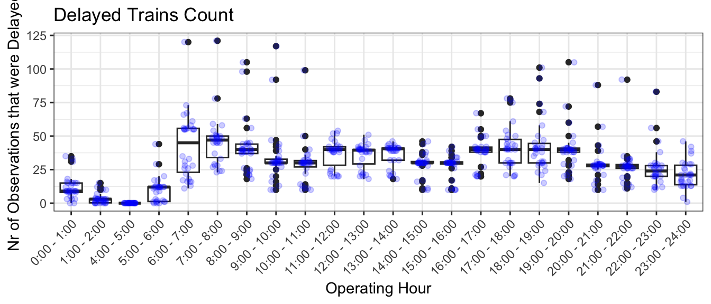

# Swiss Public Transport Winter Bottlenecks

A statistical analysis in R of delays and cancellations on the Zentralbahn network (Central Switzerland) in November 2024, combining open operational data with weather records to find out whether winter weather or operational factors drive the delays.



## Problem
Zentralbahn saw a drop in punctuality in November 2024 and suspected winter-related disruptions. The project had two goals:

1. **Root causes:** test whether weather explains the delays, or whether lines, time of day, hubs and operational events matter more.
2. **Data quality:** some historical records have missing or wrong station names. Can a model recover the station from the other variables?

## Data
- **Operations:** actual arrival and departure times of all Zentralbahn stops in November 2024 from the [OpenTransportData archive](https://archive.opentransportdata.swiss/actual_data_archive.htm) (daily "Ist-Daten" files, filtered to Zentralbahn): 91,271 stops in the final dataset.
- **Weather:** daily temperature and precipitation for Luzern, Engelberg and Meiringen from the [Swiss Federal Geoportal](https://data.geo.admin.ch).
- `data/zentrahlbahn_final.csv` is the cleaned dataset used by the report; `data/created_csv/` holds intermediate files from the data creation step.

## Approach
Each team member led two models; all work used the same cleaned dataset.

- **Neural network** (cancellations): can cancellations be predicted from day, line and station alone?
- **Linear model** (delay propagation): log-log regression of departure delay on arrival delay, extended with weather and with flags for trains starting or ending in Luzern.
- **Generalized additive model:** non-linear effects of temperature and precipitation on delays.
- **Binomial GLM:** probability that a train is delayed, by line and time of day.
- **Poisson GLM:** delay counts by hour, operation category (e.g. the reopening of the Meiringen–Interlaken line on 25 November) and weather.
- **Support vector machine** (data quality): classifying the station (Luzern vs. other) from time and route features, with linear and radial kernels and 5-fold cross-validation.

## Results
- **Delays propagate almost fully:** a 1% higher arrival delay means about 0.94% higher departure delay (R² = 0.83, 31,942 stops).
- **Luzern stabilizes:** trains starting or ending in Luzern leave with 11–13% lower departure delays than elsewhere.
- **Weather is secondary:** rain and temperature have no significant effect on delay propagation; in the GAM their effects are significant but explain only 4–12% of the deviance.
- **Operations matter more:** specific lines, rush hours and the reopening of the Meiringen–Interlaken line shift delay patterns clearly.
- **Cancellations are predictable:** the neural network identifies about 95% of cancelled trains from day, line and station.
- **Station recovery is hard:** the SVM reaches a balanced accuracy of 0.60 (precision 0.69 and recall 0.37 for Luzern), so it is only useful for flagging candidates.

Full report with code and figures: [`report/winter_bottlenecks_report.html`](report/winter_bottlenecks_report.html) (download and open in a browser).

## My contribution
Team project with Pascal Ackermann and Stefan Dreyfus (HSLU, spring 2025). I led the linear model and the support vector machine; Pascal led the Poisson GLM and the neural network, Stefan the GAM and the binomial GLM. All three of us worked on data preparation, exploratory analysis and the final report.

## How to run
Requires R (4.x) with the packages loaded in `final_documentation.Rmd`:

```r
install.packages(c("rmarkdown", "knitr", "dplyr", "tidyr", "ggplot2", "scales", "lubridate",
                   "forcats", "gridExtra", "gt", "details", "nnet", "mgcv", "gamlss.add",
                   "multcomp", "caret", "kernlab", "doParallel", "pROC", "MLmetrics"))
rmarkdown::render("final_documentation.Rmd", output_dir = "report")
```

Rendering takes about 10 minutes, mostly for the SVMs. To rebuild the dataset from scratch, download the November 2024 Ist-Daten and the weather files into `data/raw/` and run the scripts in `Scripts/` from the repository root.

## Repository structure
```
├── final_documentation.Rmd   # full analysis and report
├── report/                   # rendered HTML report
├── data/                     # cleaned dataset and intermediate files
├── Scripts/                  # dataset creation and early model scripts
├── rmd_snippets/             # exploratory model drafts, consolidated in the report
├── final_documentation_files/plots/  # static figures used by the report
└── screenshots/
```

## Limitations & next steps
- One month of data; November 2024 may not be representative of other winters.
- Weather is only available as daily averages, while delays are recorded per stop, so short local weather events are likely underestimated.
- The SVM metrics are computed on the balanced training data; a held-out test set would give a more reliable estimate.
- Next steps: add more months and hourly weather, and include operational data such as staffing or infrastructure incidents to explain more of the variance.
